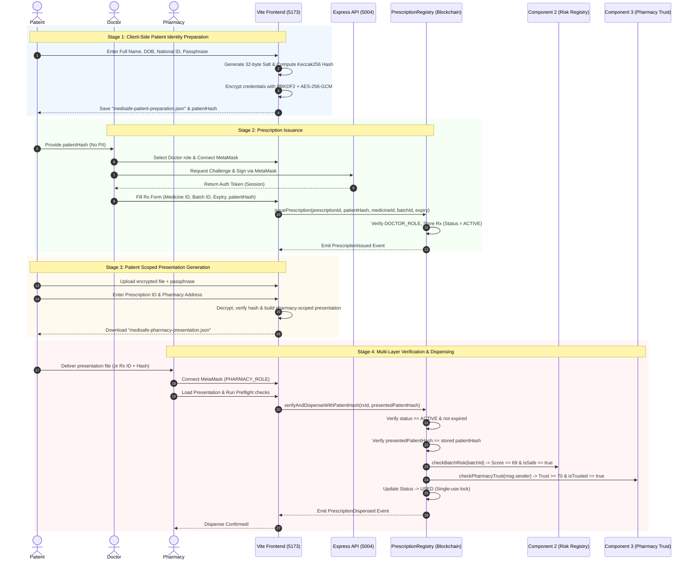

# MediSafe Chain — Component 4: Architecture & Data Flow Guide
**Component:** Component 4 (Privacy-Preserving Blockchain Prescription Management)  
**Author:** R.A.M.A. Ranasinghe (IT23142978)  
**Smart Contract:** `PrescriptionRegistry.sol` (EVM / Hardhat Localhost Chain ID: 31337)  
**Backend API:** Express REST API (Port 5004)  
**Frontend:** React + Vite Client (Port 5173)  

---

## 1. System Overview

Component 4 is responsible for **privacy-preserving prescription lifecycle management**. It bridges healthcare providers (Doctors), patients, and dispensaries (Pharmacies) through an immutable Ethereum smart contract (`PrescriptionRegistry.sol`), while strictly protecting patient Personally Identifiable Information (PII) using client-side cryptographic hashing and AES-256-GCM encryption.

### Core Architectural Principles
1. **Zero-PII On-Chain:** No patient name, date of birth, national ID, or illness data ever touches the blockchain or the backend server. Only a one-way cryptographic hash (`keccak256`) is stored on-chain.
2. **Atomic Multi-Layer Verification:** A prescription can only be dispensed if:
   - It is active and unexpired.
   - It has never been dispensed before (single-use strictly enforced).
   - The presented patient credential matches the on-chain hash.
   - **Component 2 AI Risk Check:** The prescribed medicine batch is verified safe by the `MedicineRiskRegistry` (Risk score <= 69, `isSafe == true`).
   - **Component 3 Pharmacy Trust Check:** The dispensing pharmacy holds a verified trust score (>= 70) in the `PharmacyTrust` registry.
3. **Decentralized Direct Signing:** Transaction submissions (issuing, dispensing, revoking) are executed directly from user wallets via MetaMask, preventing server impersonation and ensuring cryptographic non-repudiation.

---

## 2. End-to-End Workflow Diagram



---

## 3. Detailed Data Structures & Payloads

### Step 1: Patient Identity & Cryptographic Hashing

#### Raw Identity Structure (Client Memory Only)
```json
{
  "fullName": "Jane Doe",
  "dateOfBirth": "1990-08-14",
  "nationalId": "NIC892019482V"
}
```

#### Canonical String Construction
To ensure deterministic hashing across devices, identity attributes are normalized to lowercase, trimmed, sorted alphabetically, and concatenated with the pipe (`|`) delimiter:
```text
dateofbirth:1990-08-14|fullname:jane doe|nationalid:nic892019482v
```

#### Cryptographic Salt & Hash Generation
- **Random Salt:** A secure 32-byte hexadecimal salt is generated using `crypto.getRandomValues(32)`.
  ```text
  0x7c4f1e09b33a521de4e58b16cf29849204859a1f28b74619d08e7c2a514d89fa
  ```
- **Patient Identity Hash:** Computed using Ethereum's `solidityPackedKeccak256`:
  $$\text{patientHash} = \text{keccak256}(\text{canonicalIdentity}, \text{salt})$$
  ```text
  0x3a890f5c1209b5329fce831d10294c8e718290f6e3c1294801fb2941038e92d1
  ```

#### Encrypted Preparation Envelope (`medisafe-patient-preparation.json`)
The identity and salt are encrypted client-side using **AES-256-GCM** with keys derived via **PBKDF2-SHA256** (310,000 iterations):
```json
{
  "version": 1,
  "kdf": "PBKDF2-SHA256",
  "iterations": 310000,
  "salt": "HPYjaacon//X37JVaC7Tmg==",
  "iv": "bXnjjVBH9G/bqhIQ",
  "ciphertext": "f4wws+vSSMZ6M9weHJKJeMd4Cjh9kzgxthVMKh6TEqGus5/fy4qBYktfBfh8sqDZqOEqL717J5KAXIw0WSYZEaHzH589hVresd3Enr926iJdAVcomZ14KPYUOtsLfCG5TEBp1q6WecsXqj2FPEP449A+/lKEtLyWWLKvjZAoPMCa1EphKpYW1+Wr/rUt6xiEDLjenLnByhUlBxOZW/LOPESMhuhvqnYiBjlqFa8m6r9KLExgo3vSplOn7p7G2PdMPu2+buFOXBCc0n0UtfGat8nRH1DqAZ3Rru49NHnsnWaI04HDYwKlNieUnw=="
}
```

---

### Step 2: Role Authentication (Challenge-Response)

Healthcare actors (Doctors, Pharmacists) authenticate against the Component 4 API via EIP-191 personal signatures.

#### 1. Request Challenge (`POST /api/v1/prescriptions/auth/challenge`)
```json
{
  "role": "doctor",
  "address": "0x2a13ee1f4C69386864A271Bceb401fcd3d91c942"
}
```
**Response:**
```json
{
  "success": true,
  "data": {
    "message": "MediSafe Authentication Challenge: e38f92a1... Timestamp: 1729528900",
    "nonce": "e38f92a1...",
    "expiresAt": 1729529200
  }
}
```

#### 2. Exchange Signature for Token (`POST /api/v1/prescriptions/auth/token`)
The wallet signs `message` via MetaMask `personal_sign`.
```json
{
  "message": "MediSafe Authentication Challenge: e38f92a1... Timestamp: 1729528900",
  "signature": "0x4b78...691c"
}
```
**Response:**
```json
{
  "success": true,
  "data": {
    "token": "eyJhbGciOiJIUzI1NiIsInR5cCI6IkpXVCJ9...",
    "expiresIn": 300
  }
}
```

---

### Step 3: Prescription Issuance On-Chain

#### Arguments to `issuePrescription`
```solidity
function issuePrescription(
    bytes32 prescriptionId,
    bytes32 patientHash,
    string calldata medicineId,
    string calldata batchId,
    uint256 expiryTime
) external onlyRole(DOCTOR_ROLE);
```

| Parameter | Type | Example Value | Description |
| :--- | :--- | :--- | :--- |
| `prescriptionId` | `bytes32` | `0xa1b2c3d4e5f6...` | Deterministic hash derived from `doctorAddress + patientHash + timestamp + nonce`. |
| `patientHash` | `bytes32` | `0x3a890f5c1209...` | Cryptographic patient hash provided by the patient. |
| `medicineId` | `string` | `"MED-AMOXICILLIN-500"` | Identifier of the prescribed pharmaceutical drug. |
| `batchId` | `string` | `"BATCH-SAFE-001"` | Batch serial number linked to Component 1 & 2. |
| `expiryTime` | `uint256` | `1732120900` | UNIX timestamp (e.g. Current Time + 30 Days). |

#### Smart Contract Storage Record (`Prescription` Struct)
```solidity
struct Prescription {
    bytes32 prescriptionId;    // 0xa1b2...
    bytes32 patientHash;       // 0x3a89...
    string medicineId;         // "MED-AMOXICILLIN-500"
    string batchId;            // "BATCH-SAFE-001"
    address doctorAddress;     // 0x2a13ee1f4C69386864A271Bceb401fcd3d91c942
    uint256 issuedAt;          // 1729528900
    uint256 expiryTime;        // 1732120900
    PrescriptionStatus status; // PrescriptionStatus.ACTIVE (0)
}
```

#### Event Emitted: `PrescriptionIssued`
```solidity
emit PrescriptionIssued(
    0xa1b2c3d4e5f6...,
    0x3a890f5c1209...,
    "MED-AMOXICILLIN-500",
    "BATCH-SAFE-001",
    0x2a13ee1f4C69386864A271Bceb401fcd3d91c942,
    1732120900,
    1729528900
);
```

---

### Step 4: Patient Presentation Generation

When presenting the prescription to a pharmacy, the patient exports a scoped credential payload (`medisafe-pharmacy-presentation.json`).

#### Scoped Presentation JSON Format
```json
{
  "kind": "medisafe-patient-presentation-v1",
  "prescriptionId": "0xa1b2c3d4e5f67890123456789abcdef0123456789abcdef0123456789abcdef0",
  "patientHash": "0x3a890f5c1209b5329fce831d10294c8e718290f6e3c1294801fb2941038e92d1",
  "chainId": "31337",
  "registryAddress": "0x0165878A594ca255338adfa4d48449f69242Eb8F",
  "pharmacyAddress": "0x2376C6970c55AB66c4FFcad53A49fb21f862B613",
  "expiryTime": 1732120900
}
```

---

### Step 5: Pharmacy Verification & Dispensing

#### Dispense Transaction Call
The pharmacy calls `verifyAndDispenseWithPatientHash`:
```solidity
function verifyAndDispenseWithPatientHash(
    bytes32 prescriptionId,
    bytes32 presentedPatientHash
) external onlyRole(PHARMACY_ROLE);
```

#### Multi-Tier Verification Logic Executed in Smart Contract
```
┌─────────────────────────────────────────────────────────────┐
│ 1. Existence & Expiry Check                                 │
│    p.prescriptionId != 0 && block.timestamp <= p.expiryTime │
└──────────────────────────────┬──────────────────────────────┘
                               │ Passed
┌──────────────────────────────▼──────────────────────────────┐
│ 2. Single-Use Replay Prevention                             │
│    p.status == PrescriptionStatus.ACTIVE                    │
└──────────────────────────────┬──────────────────────────────┘
                               │ Passed
┌──────────────────────────────▼──────────────────────────────┐
│ 3. Cryptographic Patient Verification                       │
│    p.patientHash == presentedPatientHash                    │
└──────────────────────────────┬──────────────────────────────┘
                               │ Passed
┌──────────────────────────────▼──────────────────────────────┐
│ 4. Component 2 AI Risk Check (Oracle)                       │
│    riskRegistry.hasBatchRisk(batchId)                       │
│    riskRegistry.getRiskScore(batchId) <= 69                 │
│    riskRegistry.isBatchSafe(batchId) == true                │
└──────────────────────────────┬──────────────────────────────┘
                               │ Passed
┌──────────────────────────────▼──────────────────────────────┐
│ 5. Component 3 Pharmacy Trust Check (Oracle)                │
│    pharmacyTrustRegistry.getTrustScore(msg.sender) >= 70    │
│    pharmacyTrustRegistry.isPharmacyTrusted(msg.sender)      │
└──────────────────────────────┬──────────────────────────────┘
                               │ Passed
┌──────────────────────────────▼──────────────────────────────┐
│ 6. Status Mutation: p.status = PrescriptionStatus.USED      │
│    Emit PrescriptionDispensed & PrescriptionStatusChanged   │
└─────────────────────────────────────────────────────────────┘
```

#### Event Emitted: `PrescriptionDispensed`
```solidity
emit PrescriptionDispensed(
    0xa1b2c3d4e5f6...,
    0x2376C6970c55AB66c4FFcad53A49fb21f862B613, // msg.sender (Pharmacy)
    0x3a890f5c1209...,                            // Verified patientHash
    1729529900                                   // Dispensed timestamp
);
```

---

### Step 6: Revocation Lifecycle (Emergency / Cancellation)

If a prescription was issued in error or must be cancelled before dispensing, the issuing Doctor or an Administrator can call:

```solidity
function revokePrescription(
    bytes32 prescriptionId,
    string calldata reason
) external;
```
- **Permission:** Caller must be either `p.doctorAddress` or have `DEFAULT_ADMIN_ROLE`.
- **Constraint:** Prescription must be in `ACTIVE` status.
- **State Mutation:** `p.status = PrescriptionStatus.REVOKED`.
- **Event Emitted:**
  ```solidity
  emit PrescriptionRevoked(prescriptionId, msg.sender, reason, block.timestamp);
  ```

---

## 4. Cross-Component Integration Matrix

| Integration Point | Target Component | Contract / Interface | Method / Query | Requirement for Success |
| :--- | :--- | :--- | :--- | :--- |
| **Batch Verification** | **Component 2** (AI Risk Scoring) | `IMedicineRiskRegistry` | `getRiskScore(batchId)`, `isBatchSafe(batchId)` | Batch risk <= 69, `isSafe == true` |
| **Pharmacy Trust** | **Component 3** (Pharmacy Trust) | `IPharmacyTrust` | `getTrustScore(pharmacy)`, `isPharmacyTrusted(pharmacy)` | Trust score >= 70, `isTrusted == true` |
| **Batch Tracking** | **Component 1** (Traceability) | `MedicineTraceability` | `batchId` mapping | Batch exists in supply chain journey |
| **Prescription Registry** | **Component 4** (Prescription) | `PrescriptionRegistry` | `issuePrescription`, `verifyAndDispense` | Master contract orchestrating dispensing rules |

---

## 5. Security & Privacy Guarantees

1. **Zero-Knowledge Property for Patient Identity:**
   Even if an attacker gains full access to the blockchain history, block explorer, and backend server logs, they cannot identify the patient because `patientHash` is a salt-randomized Keccak256 hash.
2. **Replay & Double-Dispense Protection:**
   The `p.status` state machine immediately transitions to `USED` in the same atomic transaction as the verification checks. Attempting to present the same prescription twice reverts with `PrescriptionNotActive`.
3. **Phishing & Cross-Pharmacy Replay Protection:**
   The patient presentation payload explicitly binds the dispensing `pharmacyAddress`. If intercepted by an adversary, it cannot be submitted by another pharmacy address because `msg.sender` in the smart contract must match the presentation scope.
4. **Counterfeit Batch Mitigation:**
   Even if a rogue doctor attempts to prescribe a counterfeit batch, the smart contract prevents dispensing because Component 2's AI Risk Registry flags batches with risk >= 70 as unsafe.
